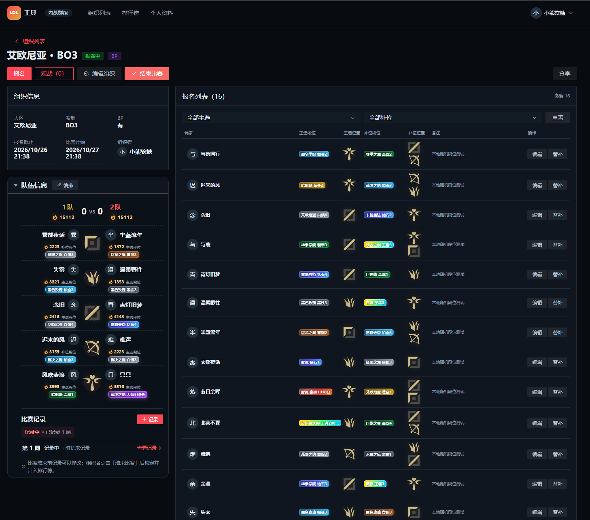
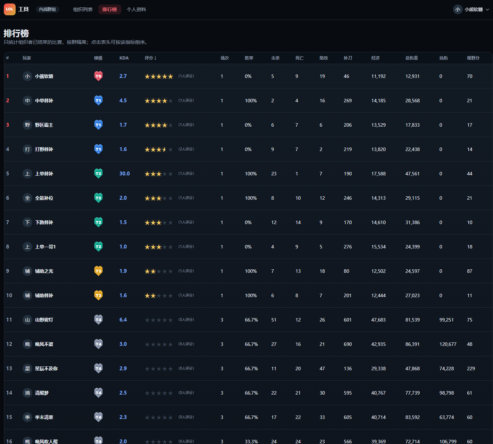
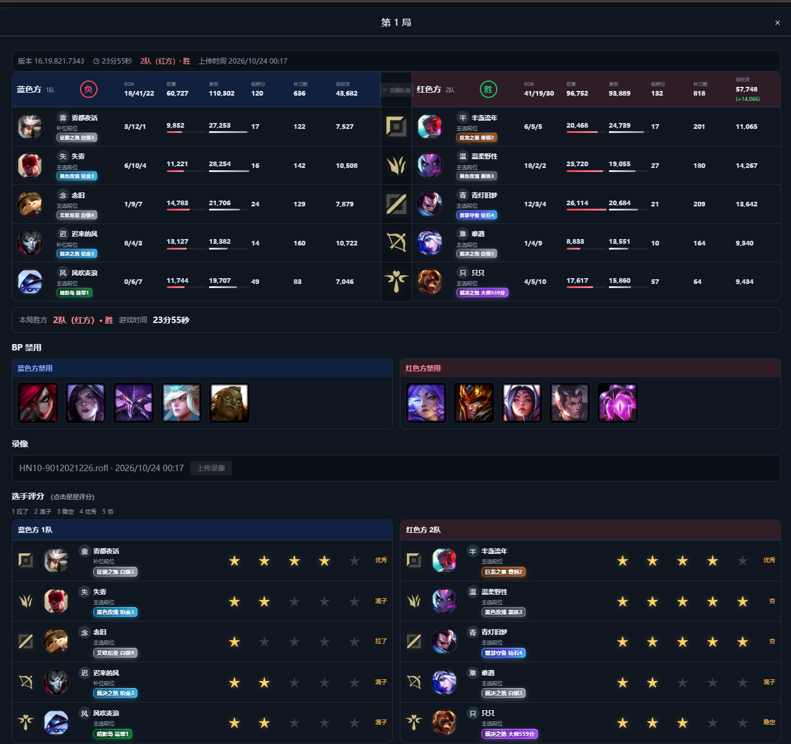

# LOL 群内战报名工具（lol-civil-war）

[简体中文](README.md) | [English](README.en.md)

<p align="center">
  
  
  
</p>

面向各类《英雄联盟》社群（QQ 群、微信群、Discord 等）的 5v5 自定义内战组织工具：报名、自动战力平衡、对局记录、赛后评分与排行榜。

后端由 Go 1.27.3 重写，单二进制 + MySQL 8，内置前端静态资源；按顺序执行几条命令即可完成部署。

## 功能

- **邮箱账号**：邮箱 + 密码注册/登录，不依赖 QQ；每个账号由系统生成唯一 `user_no`。
- **QQ 快捷登录（可选）**：配置 QQ 互联后才出现；首次使用会直接创建 QQ 账号并登录，不再要求邮箱密码；邮箱注册的用户可在个人资料里再绑定 QQ。
- **按群隔离**：所有数据按群隔离，URL 使用随机 key，不暴露群号。
- **白名单管理**：环境变量引导 + 数据库白名单，线上可用命令即时添加/移除群。
- **群内资料**：昵称、QQ 号（可修改，群内唯一）、最高段位、擅长位置。
- **内战组织**：自定义标题、大区、BO1/BO3/BO5、是否 BP、报名截止/开赛时间、备注。
- **报名与替补**：主选/补位位置 + 两套段位；截止前可自行修改，截止后由组织者代改。
- **自动战力平衡**：按段位、大区系数、位置影响力计算战力，回溯搜索输出 5 套最平衡阵容。
- **对局记录**：红蓝双方阵容、KDA/补刀/经济/伤害、BP 禁用；上传 `.rofl` 自动填充战绩。
- **结束比赛**：组织者统一锁定记录；之后报名者/观战者可对每局出场玩家打 1–5 星。
- **排行榜与个人分析**：评分、KDA、胜率、场均数据、最佳/最差队友、最近对局。
- **PC / 手机自适应**：Vue 3 + Arco Design Vue。

## 技术栈

| 组件 | 选型 |
| --- | --- |
| 后端 | Go 1.27.3（标准库 `net/http`，无 Web 框架） |
| 数据库 | MySQL 8.0+ / 8.4 LTS（驱动 `github.com/go-sql-driver/mysql`） |
| 前端 | Vue 3 + Arco Design Vue + Vite，构建产物嵌入二进制 |
| 部署 | Docker Compose：应用容器 + MySQL 容器 |

## 部署（从 GitHub 拉取，按顺序执行）

> **第一次部署 / 不熟悉 Linux？**
> 建议先看 [小白版部署教程](docs/deploy-beginner.md)：从安装 Docker、国内网络、SSH 隧道到 Caddy HTTPS 和常见报错，按步骤操作。

```bash
# 1. 拉取代码
git clone https://github.com/chyoumu114/lol-civil-war.git
cd lol-civil-war/deploy

# 2. 准备配置
cp .env.example .env

# 3. 编辑 .env：至少填写
#    LCW_ALLOWED_GROUPS=你的群号
#    LCW_BASE_URL=https://你的域名
#    MYSQL_PASSWORD=随机强口令
#    MYSQL_ROOT_PASSWORD=随机强口令
#    （可选 QQ 快捷登录：LCW_QQ_APP_ID / LCW_QQ_APP_KEY）

# 4. 启动（首次会构建应用镜像、启动 MySQL 并自动建表）
docker compose up -d --build

# 5. 检查
docker compose ps
curl -fsS http://127.0.0.1:18020/api/health
```

在服务器本机或通过 SSH 隧道访问 `http://localhost:18020/`，首次使用点「注册」用邮箱创建账号即可；远程服务器直接访问公网 IP 默认不可用，见小白教程。数据在 `lol-civil-war-mysql-data` 卷里。

> Compose 自带 `build`：从源码部署时用 `docker compose up -d --build` 即可。
> 生产也可以改为你发布到镜像仓库的具体镜像，此时用 `docker compose up -d` 直接拉取：
> `LCW_IMAGE=<registry>/<namespace>/lol-civil-war:v0.2.0`。

### 从源码运行

需要 Go 1.27.3+、Node.js 22.23.4+、一个可用的 MySQL 8 实例与数据库：

```bash
make build

export LCW_DB_HOST=127.0.0.1 LCW_DB_PORT=3306 \
       LCW_DB_USER=lcw LCW_DB_PASSWORD=你的密码 LCW_DB_NAME=lol_civil_war

LCW_ALLOWED_GROUPS=123456789 LCW_DEV_LOGIN=true ./bin/lol-civil-war
```

首次启动会自动建表；数据库需要事先创建（字符集 `utf8mb4`）。

### 本地开发

```bash
# 终端 1：自动启动开发 MySQL（127.0.0.1:3307）+ 后端（8080）
make dev

# 终端 2：前端热更新（5173，代理 /api 与 /auth 到 8080）
cd web && npm install && npm run dev
```

`make dev` 会用 Docker 启动 `lol-civil-war-mysql-dev`（端口 3307，库 `lol_civil_war_dev`）。
如果已经有自己的 MySQL，直接指定连接即可跳过 Docker：

```bash
LCW_DB_HOST=127.0.0.1 LCW_DB_PORT=3306 \
LCW_DB_USER=lcw LCW_DB_PASSWORD=你的密码 LCW_DB_NAME=lol_civil_war \
make dev
```

如果后端不在 8080，前端代理地址可覆盖：

```bash
VITE_API_TARGET=http://127.0.0.1:18020 npm run dev
```

开发登录：

```
http://localhost:8080/auth/dev?qq=10001&nickname=测试玩家&redirect=/
```

> 生产环境必须保持 `LCW_DEV_LOGIN=false`，并使用 HTTPS。

## 配置

应用通过环境变量（或 `.env`）配置；Compose 会读取 `deploy/.env` 用于插值和容器环境。

| 变量 | 默认值 | 说明 |
| --- | --- | --- |
| `LCW_ADDR` | `:8080` | 监听地址 |
| `LCW_DATA_DIR` | `./data` | 数据目录（上传临时文件、可选图标） |
| `LCW_BASE_URL` | `http://localhost:8080` | 对外访问地址，影响 QQ 回调与 Cookie Secure |
| `LCW_TIMEZONE` | `Asia/Shanghai` | 展示时区 |
| `LCW_ALLOWED_GROUPS` | 空 | 群号白名单，逗号分隔；**为空时拒绝所有群** |
| `LCW_DEV_LOGIN` | `false` | 是否开放 `/auth/dev` |
| `LCW_QQ_APP_ID` | 空 | 可选：QQ 互联 AppID，配置后才启用快捷登录 |
| `LCW_QQ_APP_KEY` | 空 | 可选：QQ 互联 AppKey |
| `LCW_QQ_REDIRECT_URI` | `${BASE_URL}/auth/qq/callback` | QQ 回调地址 |
| `LCW_SESSION_TTL_HOURS` | `720` | 登录会话有效期 |
| `LCW_ROFL_MAX_KB` | `131072` | 录像上传上限（128MB） |
| `LCW_COOKIE_SECURE` | `auto` | `auto` 时按 `LCW_BASE_URL` 是否为 https 决定 |
| `LCW_TRUST_PROXY` | `true` | 是否信任 `X-Forwarded-*` |
| `LCW_CHAMPION_ICON_DIR` | `${DATA_DIR}/champions` | 本地英雄头像目录 |
| `LCW_DDRAGON_VERSION` | 空（自动探测） | DataDragon 英雄数据版本；部署模板默认固定 16.20.1 |
| `LCW_DB_DSN` | 空 | 完整 MySQL DSN；设置后忽略下面的分项 |
| `LCW_DB_HOST` / `LCW_DB_PORT` | `127.0.0.1` / `3306` | MySQL 地址 |
| `LCW_DB_USER` / `LCW_DB_PASSWORD` | `root` / 空 | MySQL 账号 |
| `LCW_DB_NAME` | `lol_civil_war` | 数据库名 |

Compose 额外使用：`MYSQL_DATABASE`、`MYSQL_USER`、`MYSQL_PASSWORD`、`MYSQL_ROOT_PASSWORD`、`MYSQL_IMAGE`、`LCW_IMAGE`、`LCW_BIND`。

### 账号与 QQ 快捷登录

不配置 QQ 互联时，登录页只提供邮箱注册/登录，功能完整可用。

QQ 快捷登录是可选能力：

1. 在 [QQ 互联开放平台](https://connect.qq.com/) 创建网站应用；
2. 回调地址填 `https://你的域名/auth/qq/callback`；
3. 把 AppID / AppKey 写入 `LCW_QQ_APP_ID` / `LCW_QQ_APP_KEY`；
4. 设置 `LCW_BASE_URL=https://你的域名` 并重启容器。

配置 QQ 互联后，登录页默认突出 QQ 快捷登录，邮箱/密码入口折叠在下方。

规则：

- 每个账号有系统生成的唯一 `user_no`；QQ OpenID 只是登录方式；
- **QQ 快捷登录不需要邮箱和密码**：首次登录会直接创建只有 QQ 的账号并进入网站；
- 邮箱注册不自动生成昵称；昵称和群内 QQ 号仍是群内报名必填资料，首次进群后补全；
- 首次通过 QQ 快捷注册时，群昵称默认使用 QQ 返回的昵称；
- 已有邮箱账号仍可展开“使用邮箱账号登录 / 注册”登录，之后可在「个人资料 → 账号 → 绑定 QQ」；
- 旧版数据里的 QQ 账号可直接登录，不再要求补全邮箱密码。

QQ 互联只返回 OpenID，不返回 QQ 号。群内的 5–12 位 QQ 号由用户自己填写，可修改，但同一群内不能重复。

### 白名单群管理

`LCW_ALLOWED_GROUPS` 是启动引导白名单（始终允许，适合只维护一个群）。日常新增群推荐写入数据库白名单，**立即生效、无需重启**：

```bash
# Docker 部署（在 deploy 目录执行）
docker compose exec app /app/lol-civil-war group add 123456789
docker compose exec app /app/lol-civil-war group list
docker compose exec app /app/lol-civil-war group remove 123456789

# 源码运行（需带上 LCW_DB_* 环境变量）
go run ./cmd/lol-civil-war group add 123456789

# 本地开发库（make dev 启动的 3307）
LCW_DB_HOST=127.0.0.1 LCW_DB_PORT=3307 LCW_DB_USER=root \
LCW_DB_PASSWORD=lcw-dev LCW_DB_NAME=lol_civil_war_dev \
go run ./cmd/lol-civil-war group add 123456789
```

> `make dev` 只把数据库环境变量传给后端进程；另开终端执行 CLI 时不会继承，需要像上面一样显式指定。

`group add` 支持追加备注：`group add 123456789 "周五内战群"`。

## 英雄头像与英雄库更新

英雄头像和资料来自 **DataDragon CDN**：

```text
https://ddragon.leagueoflegends.com/cdn/
```

仓库不提交头像文件。头像加载顺序：

```text
DataDragon CDN → 服务器本地 /champions/{key}.png → 英雄名首字
```

线上本地目录默认是 `/data/champions`，由 `LCW_CHAMPION_ICON_DIR` 配置。

更新英雄库和头像：

```bash
# 默认更新到 16.20.1
make champions

# 指定版本
make champions CHAMPION_VERSION=16.20.1

# 或直接运行脚本
python3 scripts/update-champions.py --version 16.20.1
```

命令会：

1. 拉取 DataDragon `champion.json`；
2. 更新 `internal/domain/champion/library.json` 的版本、英雄名和称号；
3. 追加新英雄（新英雄的 `positions`/`aliases` 为空，可按需手工补）；
4. 下载头像到 `data/champions/`。

更新完英雄列表后重新构建项目，并把部署 env 的 `LCW_DDRAGON_VERSION` 改成同一版本（或留空自动探测）：

```bash
make build
```

线上把头像放进容器数据卷：

```bash
docker cp data/champions/. lol-civil-war:/data/champions/
```

## 从旧版导入数据

仓库自带 `tools/legacy-import`，可把旧版 `lol-youmu-tools`（Laravel）的 MySQL 数据导入新库，保留主键、转换时间并自动把旧群加入白名单：

```bash
# 先备份目标库；-truncate 会清空目标业务表
go run ./tools/legacy-import \
  -source 'root:旧库密码@tcp(127.0.0.1:33062)/lolyoumu?charset=utf8mb4' \
  -target 'root:新库密码@tcp(127.0.0.1:3307)/lol_civil_war?charset=utf8mb4' \
  -truncate
```

## 部署拓扑

```
浏览器 → Nginx/Caddy (443) → 127.0.0.1:18020 → app 容器
                                                   └── mysql:3306（内部网络）
                                                         └── 卷 lol-civil-war-mysql-data
```

HTTPS、反向代理、备份、升级与故障排查见 [docs/deploy.md](docs/deploy.md)。

## 测试

```bash
# 启动一个测试用 MySQL 8
docker run -d --name lcw-mysql-test -e MYSQL_ROOT_PASSWORD=root \
  -p 127.0.0.1:3307:3306 mysql:8.4

# 单元 + HTTP 集成测试（每个测试自动建独立库并清理）
LCW_TEST_MYSQL_DSN='root:root@tcp(127.0.0.1:3307)/' go test ./...

# 端到端（需要服务开启开发登录）
python3 scripts/e2e.py --base http://127.0.0.1:8080 --group 123456789
```

## 目录结构

```
cmd/lol-civil-war/       程序入口
internal/config/         环境变量与 .env 配置
internal/domain/         纯业务规则：段位/战力、赛制、自动匹配、ROFL 解析、英雄库
internal/store/          MySQL 持久化（schema.sql + 各聚合的查询）
internal/service/        应用服务：权限、事务、DTO 组装
internal/web/            HTTP 路由、会话、CSRF、限流、静态资源
internal/webui/          内嵌前端产物（dist 由构建生成）
web/                     Vue 3 前端源码
deploy/                  Dockerfile、compose、配置模板
docs/                    架构、接口、部署文档
scripts/                 发布 / 远程部署 / 端到端验收 / 图标下载
```

## 数据与隐私

- 业务数据在 MySQL；备份与恢复见部署文档。
- 上传的 `.rofl` **不落盘**，只保存 sha256 与解析结果。
- 接口对 QQ 号做脱敏（保留前段，隐藏最后三位）；群号不出现在 URL 中。
- 密码使用 bcrypt 哈希存储；账号唯一标识是系统生成的 `user_no`，不依赖 QQ OpenID。
- 仓库不包含任何真实群号、服务器、域名或凭据；部署时通过环境变量注入。

## 已知限制

- 默认单实例部署；会话存 MySQL，但限流在进程内，多副本需要额外的共享限流。
- ROFL 录像从游戏加载开始记录，**不包含 Ban/Pick**；BP 需手动记录。
- 仅支持 14.11+ 的 ROFL2 录像；14.9–14.10 录像无元数据。
- 报名规模很大时自动匹配可能触及搜索预算（默认 300 万节点），结果不保证全局最优。
- 仓库不含英雄头像（Riot 版权素材）；默认使用 DataDragon CDN，失败时回退到本地 `/data/champions`，没有本地文件则显示英雄名首字。头像可用 `make champions` 下载。

## 许可与声明

本项目使用 [GPL-3.0](LICENSE) 许可。

本工具与 Riot Games 无关联；League of Legends、英雄名称与相关素材是 Riot Games, Inc. 的商标/财产，不属于 GPL 授权范围。详见 [NOTICE](NOTICE)。

英雄头像数据来源：[DataDragon CDN](https://ddragon.leagueoflegends.com/cdn/)。头像文件不进入仓库，仅由部署方按需缓存到本地。
